<p align="center">
  
  
  
  
</p>


Inside any project. Needs Node 20+ and Python 3.9+, installs nothing into your project.

```bash
npx @xand0dev/traceflow
```

The map opens at `localhost:4317` and redraws on every save.




```bash
claude mcp add traceflow -- npx -y @xand0dev/traceflow mcp
```

<details>
<summary><b>Codex</b>, <b>Claude Desktop</b>, <b>Cursor</b></summary>

`~/.codex/config.toml`

```toml
[mcp_servers.traceflow]
command = "npx"
args = ["-y", "@xand0dev/traceflow", "mcp", "/absolute/path/to/your/project"]
```

`claude_desktop_config.json` or `.cursor/mcp.json`

```json
{ "mcpServers": { "traceflow": { "command": "npx", "args": ["-y", "@xand0dev/traceflow", "mcp", "/absolute/path/to/your/project"] } } }
```

Desktop apps start servers with a short `PATH`. If `npx` is not found, use the full path from `which npx`.

</details>

<details>
<summary>Tools the agent gets</summary>

| | |
|:---|:---|
| `architecture` | Pages → endpoints → models with `file:line`. Optional `focus` word. |
| `trace` | Where an endpoint lives, what it uses, who calls it, its recent errors. |
| `changes` | What moved in the architecture during this session. |
| `traffic` | Recent requests, or only failures. |
| `open_map` | The map URL. |
| `reset_changes` | Track changes from now on. |

</details>




<details>
<summary>Django and React snippets</summary>

Copy [`sdk/django_middleware.py`](sdk/django_middleware.py) into your project:

```python
if DEBUG:
    MIDDLEWARE.insert(0, "myproject.traceflow_middleware.TraceFlowMiddleware")
```

Copy [`sdk/telemetry_client.js`](sdk/telemetry_client.js) into your app as `src/traceflow.js`:

```js
import { initTraceFlow } from './traceflow';
if (import.meta.env.DEV) initTraceFlow();
```

No app running yet? `npx @xand0dev/traceflow simulate` sends demo traffic to the open map.

</details>




<details>
<summary>What it understands today</summary>

**Any language**: blocks from folders and files, links from imports (Python, JS/TS), descriptions from `package.json`, `pyproject.toml`, docstrings and README, a picture per kind of block. No AI involved.<br/>
**Django**: `ROOT_URLCONF` (settings file or package), nested `include()`, `path` / `re_path`, DRF routers and viewsets, `APIView` methods, `@api_view`, models including inherited and custom user models, relations, which models each view touches.<br/>
**React**: React Router routes, pages and their imports, `fetch` / axios calls to `/api/...`.<br/>
**React Native**: React Navigation stacks and tabs, expo-router screens.<br/>
**Not yet**: FastAPI, Express, Next.js API routes, routers registered in loops.

</details>

<details>
<summary>Develop</summary>

```bash
git clone https://github.com/xand0dev/TraceFlow.git
cd TraceFlow/cli && npm install && npm test
```

`npm test` runs the parser and diff tests and drives the MCP server with a real MCP client. `node scripts/capture.mjs` re-records the demo. `python3 docs/readme/make_assets.py` regenerates these images. The VS Code extension lives in `src/`.

</details>

<br/>

<p align="center">
  <a href="https://www.npmjs.com/package/@xand0dev/traceflow"></a>
  &nbsp;
  <a href="https://github.com/sponsors/xand0dev"></a>
  &nbsp;
  <a href="https://www.patreon.com/xand0dev"></a>
</p>

<p align="center"><sub>MIT · <a href="https://github.com/xand0dev">xand0dev</a></sub></p>
