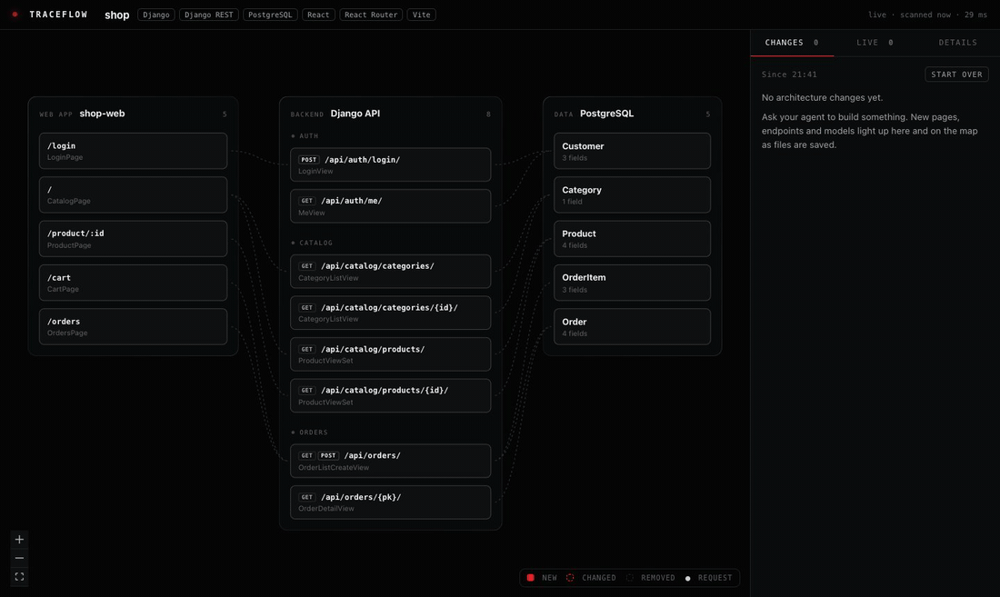
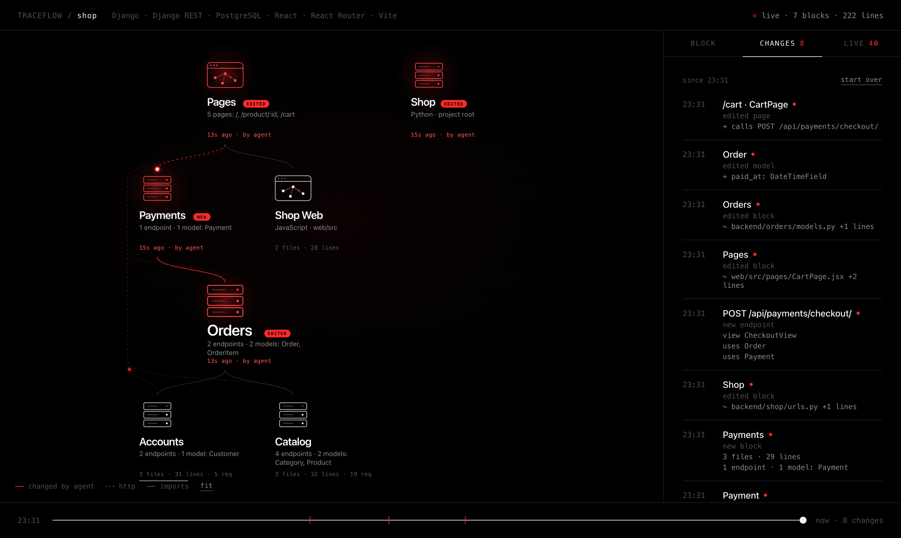
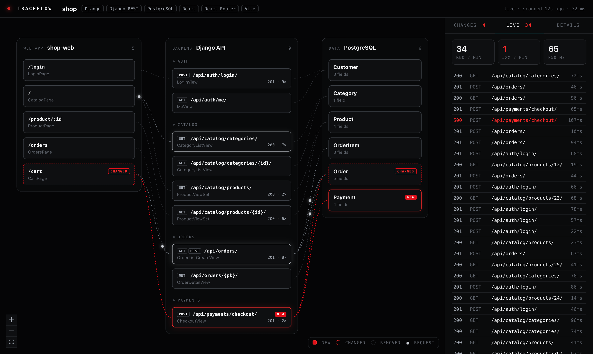
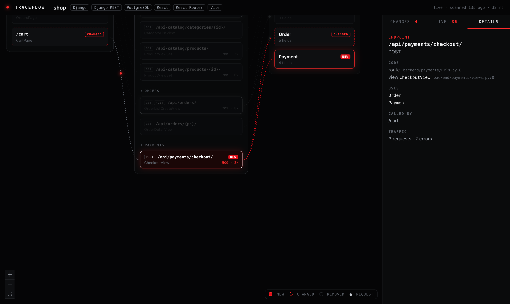
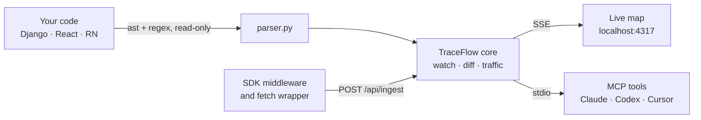

<p align="center">
  
</p>

<p align="center">
  <a href="#quick-start"></a>
  <a href="#connect-your-agent"></a>
  <a href="LICENSE"></a>
</p>

You build with Claude Code, Codex or Cursor. The agent writes fifty files and says "done". **What did it actually build?** Which page calls which endpoint, which model got a new field, and does the request really reach the database?

TraceFlow answers that with a picture instead of a wall of text. It reads your project, draws it as a live map, lights up everything the agent adds or changes as files are saved, and shows real requests moving from web to API to database. The same map is available to the agent itself over MCP.

<p align="center">
  
</p>
<p align="center"><sub>An agent adds payments to a Django + React shop. New parts glow red, changed parts get a dashed outline, dots are live requests, red dots are 5xx.</sub></p>

## Three views

<table>
<tr>
<td width="33%" valign="top">

**Map: what is what**

Pages, the endpoints each page calls, the models each endpoint uses, the database behind them. Plain names, every item linked to its file and line.

</td>
<td width="33%" valign="top">

**Changes: what the agent did**

Everything added, changed or removed since the session started, on the map and as a list. `+ paid_at: DateTimeField` beats scrolling a 900-line diff.

</td>
<td width="33%" valign="top">

**Live: does it work**

Real requests from your running app, matched to the endpoint in code. Status, timing, error rate, and calls that hit no endpoint at all.

</td>
</tr>
</table>

<p align="center">
  
</p>

<table>
<tr>
<td width="50%"></td>
<td width="50%"></td>
</tr>
</table>

## Quick start

Needs Node 20+ and Python 3.9+ (only the standard library, nothing is installed into your project).

```bash
git clone https://github.com/xand0dev/TraceFlow.git
cd TraceFlow/cli && npm install && npm run build && npm link
```

Then, inside any Django and/or React project:

```bash
traceflow
```

The map opens at `http://localhost:4317` and follows your saves. Try it on the bundled demo:

```bash
traceflow examples/shop
```

```bash
traceflow simulate
```

`simulate` sends fake traffic to the running map so you can see the Live view without starting the app.

## Connect your agent

`traceflow mcp` is an MCP server. It also serves the map, so connecting it is all you need: open `http://localhost:4317` next to the chat and watch the agent work.

**Claude Code**, inside your project:

```bash
claude mcp add traceflow -- traceflow mcp
```

**Codex**, in `~/.codex/config.toml`:

```toml
[mcp_servers.traceflow]
command = "traceflow"
args = ["mcp", "/absolute/path/to/your/project"]
```

**Claude Desktop** and **Cursor**, in `claude_desktop_config.json` or `.cursor/mcp.json`:

```json
{
  "mcpServers": {
    "traceflow": { "command": "traceflow", "args": ["mcp", "/absolute/path/to/your/project"] }
  }
}
```

Desktop apps start servers with a short `PATH`. If `traceflow` is not found, use the full path from `which traceflow`, and set `TRACEFLOW_PYTHON` if Python lives somewhere unusual.

What the agent gets:

| Tool | What it answers |
|:---|:---|
| `architecture` | The whole app: pages → endpoints → models, with `file:line`. Optional `focus` word. |
| `trace` | Where an endpoint is routed and implemented, what it uses, who calls it, its recent errors. |
| `changes` | What moved in the architecture during this session. Good for the agent's own summary. |
| `traffic` | Recent requests, or only failures with `errors_only`. |
| `open_map` | The map URL to hand to you. |
| `reset_changes` | Start tracking changes from now, before a new task. |

Tested with Claude Code and Codex over stdio.

## Live traffic

Copy one file from [`sdk/`](sdk) into your app. Both have no dependencies, send from the background, and stay silent when the map is not running.

**Django**: copy [`sdk/django_middleware.py`](sdk/django_middleware.py) into your project, then in `settings.py`:

```python
if DEBUG:
    MIDDLEWARE.insert(0, "myproject.traceflow_middleware.TraceFlowMiddleware")
```

**React / React Native**: copy [`sdk/telemetry_client.js`](sdk/telemetry_client.js) into your app as `src/traceflow.js`:

```js
import { initTraceFlow } from './traceflow';

if (import.meta.env.DEV) initTraceFlow(); // React Native on a device: initTraceFlow({ url: 'http://<your-ip>:4317' })
```

Anything else can `POST` JSON to `http://localhost:4317/api/ingest`:

```json
{ "target": "/api/orders/42/", "method": "GET", "status": 200, "duration_ms": 31, "source": "worker" }
```

## How it works



- **Read-only.** The parser uses Python's `ast` and never imports, runs or writes to your project.
- **Local.** Everything binds to `127.0.0.1`. No accounts, no cloud, no AI calls of its own.
- **Deterministic.** The map comes from code, not from a model's guess, so it does not invent services.

## What it understands today

| | Detected |
|:---|:---|
| **Django** | `manage.py`, `ROOT_URLCONF` (settings file or package), nested `include()`, `path` / `re_path`, DRF routers and viewsets (registered with literal prefixes), `APIView` methods, `@api_view`, models (including inherited and custom user models), fields, `ForeignKey` / `OneToOne` / `ManyToMany` links, which models each view touches, database engine |
| **React** | React Router (`<Route>` and route objects), pages and their local imports, `fetch` / axios / client calls to `/api/...` with method |
| **React Native** | React Navigation stacks and tabs, expo-router `app/` screens |
| **Stack** | Django REST, Celery, Channels, Vite, Next.js, TanStack Query, Redux, Zustand, Tailwind, TypeScript and more from `package.json` and requirements |

## VS Code extension

The original extension still lives in this repo (`src/extension.ts`) and on the [Marketplace](https://marketplace.visualstudio.com/items?itemName=xand0dev.traceflow-viz) and [Open VSX](https://open-vsx.org/extension/xand0dev/traceflow-viz). It draws the static map inside the editor. The code in this repo now uses the new parser; the published 0.1.0 does not yet. Live traffic and the change view are in the `traceflow` map.

## Roadmap

- [ ] `npx traceflow` from npm
- [ ] FastAPI, Express and Next.js API routes
- [ ] A panel inside Claude Code desktop, next to the chat
- [ ] Draw the plan before the code: sketch pages and endpoints, then hand them to the agent
- [ ] Architecture diff as a pull request comment

## Develop

```bash
cd cli && npm install && npm test
```

`npm test` builds, runs the parser and diff tests, and drives the MCP server with a real MCP client. `node scripts/capture.mjs` re-records the demo GIF and screenshots (needs Chrome and ffmpeg).

<p align="center">
  <a href="https://www.patreon.com/xand0dev"></a>
  <a href="https://github.com/sponsors/xand0dev"></a>
</p>

<p align="center"><sub>MIT · built by <a href="https://github.com/xand0dev">xand0dev</a></sub></p>
