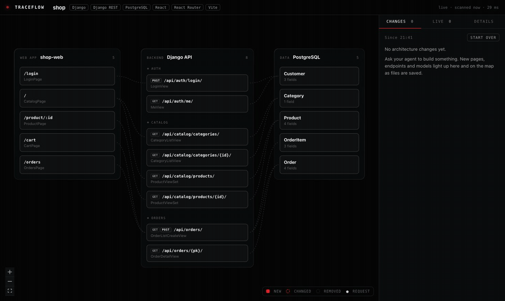

<p align="center">
  
</p>

You build with Claude Code, Codex or Cursor. The agent writes fifty files and says "done". TraceFlow shows what it actually built: a live map of your app (pages → endpoints → models → database), everything the agent added or changed lit up as files are saved, and real requests moving through it. The same map is available to the agent over MCP.

<p align="center">
  
</p>

## Run it

Needs Node 20+ and Python 3.9+. Inside a Django and/or React project:

```bash
npx @xand0dev/traceflow
```

The map opens at `http://localhost:4317` and follows your saves.

## Connect your agent

Claude Code, inside your project:

```bash
claude mcp add traceflow -- npx -y @xand0dev/traceflow mcp
```

Codex, in `~/.codex/config.toml`:

```toml
[mcp_servers.traceflow]
command = "npx"
args = ["-y", "@xand0dev/traceflow", "mcp", "/absolute/path/to/your/project"]
```

Claude Desktop or Cursor:

```json
{ "mcpServers": { "traceflow": { "command": "npx", "args": ["-y", "@xand0dev/traceflow", "mcp", "/absolute/path/to/your/project"] } } }
```

Tools: `architecture`, `trace`, `changes`, `traffic`, `open_map`, `reset_changes`. The MCP server also serves the map.

## Commands

Install globally with `npm i -g @xand0dev/traceflow` to get the `traceflow` command.

```
traceflow [dir]            Open the live map (default: current folder)
traceflow mcp [dir]        MCP server for Claude, Codex or Cursor (also serves the map)
traceflow scan [dir]       Print the architecture as text (--json for raw data)
traceflow simulate [url]   Send demo traffic to a running map
traceflow setup            Print agent config snippets
```

Live traffic needs one small file in your app (Django middleware or a fetch wrapper), or a `POST` to `/api/ingest`. See the [full README](https://github.com/xand0dev/TraceFlow#live-traffic).

Read-only, local only, no accounts and no AI calls of its own. MIT.
